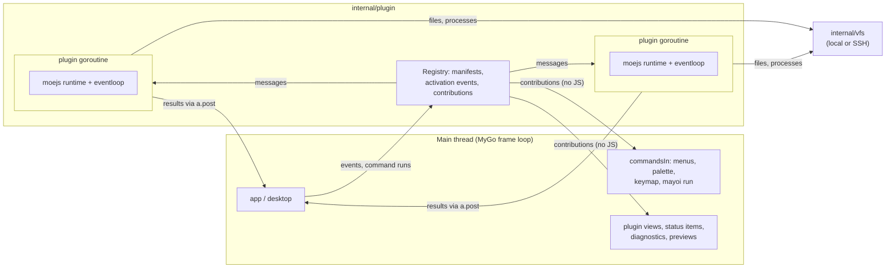

# Plugins: design

Status: built, all five phases, in one change. This is the design of Mayoi's plugin system: what plugins can do, how
they run, the API they see, and the order it was planned in. The author's guide is [PLUGINS.md](PLUGINS.md), and
[ARCHITECTURE.md](ARCHITECTURE.md#plugins) tours the code. Where the build differs from the plan below, this list says
how:

- **Views** show in the sidebar only, beside Explorer, Search and Source Control; `location` is not read. Webviews show
  there too.
- **Menus** are `plugins`, `explorer/context` and `tab/context`. The editor's own menu is MyGo's, which takes no items.
- **Problems** is a box of quick open's kind (**Show Problems**), with the count in the status bar and the message of
  the caret's line beside it, rather than a panel.
- **Hover and completion** are commands, **Show Hover** in a card and **Complete Word** (⌃Space) in a box, rather than
  a popup under the pointer or the caret. The language server client does diagnostics, hover, definition, completion
  and formatting; references and rename are not done.
- **Terminal links** match the links the terminal finds itself, URLs and paths, not any text.
- **Shortcuts plugins could not take** are offered on the Plugins page of the settings window, not the shortcuts
  editor.
- **`mayoi plugin dev`** links the folder and reloads on save; the log is in **Plugins → Show Plugin Log**, not
  followed in the shell.
- **`mayoi --disable-plugins`** is an option of the command, which a running Mayoi takes, rather than a flag the app
  starts with (macOS's `open` passes none).
- **`mayoi.d.ts`** is written by hand, beside the prelude, not generated with `tsgen`.
- **Bundled plugins** are Word Count and TODOs. Mermaid and math stayed in Go but run on moejs now, so goja is gone;
  Mayoi's themes stayed in Go, and plugin themes join them.
- **The index** is read from `mayoi-editor/plugins`, which does not exist yet: the Plugins page and `mayoi plugin
  search` say so until it does.

## Goals

- **A platform, not a macro system.** Plugins add commands, react to the editor, check and format code, draw UI,
  contribute themes and languages, and later bring language servers. Mayoi's own features move onto the same API as
  bundled plugins, which is how we know the API is enough.
- **Stay small and fast.** No Node, no Electron, no webview unless a plugin asks for one. A plugin costs nothing until
  something it declared happens, and a slow or broken plugin never stalls a frame.
- **Native by default.** Plugins describe UI and Mayoi draws it with MyGo widgets in the current theme. A webview is an
  escape hatch, not the norm.
- **Works on SSH folders unchanged.** Plugins run on this machine and reach files and programs through `internal/vfs`,
  so a plugin written for local folders works on a remote one with nothing installed on the host.
- **Easy to write, for people and for agents.** TypeScript with no build step, hot reload, one-file user scripts,
  generated types, and a CLI to scaffold, develop and install.

## Non-goals

- Running VS Code extensions. Their API is too large and assumes Node. We take their **formats** where that is cheap:
  keybindings (already), themes, snippets.
- A security sandbox. Plugins are trusted the way settings are: installing one means trusting it, as
  [new-api, sayrud and komari](#prior-art) also document. Budgets exist to keep the editor responsive, not to contain
  hostile code.
- Plugins on the SSH host. Everything runs locally.
- Per-project plugins in `.mayoi/plugins`. Cloning a repository should never run its code. This can come later with a
  trust prompt.

## Decisions

| Question             | Decision                                                                                      |
| -------------------- | --------------------------------------------------------------------------------------------- |
| Runtime              | [moejs](https://github.com/MoeForge/moejs) v0.1.0, pure Go, with its `eventloop` and `webapi` |
| Trust                | Trusted like settings: no permission prompts                                                  |
| Install              | A folder in `~/.mayoi/plugins`, plus `mayoi plugin install <git-url>`                         |
| UI                   | Declarative native views, plus an opt-in webview panel                                        |
| Built-in features    | Move gradually onto the API as bundled plugins                                                |
| Language features    | Diagnostics and formatters first, an LSP client later                                         |

Why moejs over goja, which Mayoi used for Mermaid and MathJax before: it starts a runtime in about 1.4 µs and calls
in about half Sobek's time, supports modern ES and strips TypeScript, gives a runtime no host capability until the
host adds it, and has a memory limit a script cannot catch. The risks are that it reached v0.1.0 on 2026-11-09 and
has one maintainer, so we pin the version, keep every moejs call inside `internal/plugin`, and run a smoke test of the
bundled plugins on each upgrade. Mermaid and MathJax moved to moejs too, and goja went.

## Architecture



### One actor per plugin

Each active plugin has one goroutine that owns its moejs runtime and event loop. The main thread never runs plugin
JavaScript. It sends the plugin a message (run this command, this document was saved, this button was clicked) and
gets the answer through `a.post` on a later frame, as background Git and search work already do.

- A plugin keeps its state between calls, which events, status items and views need.
- Plugins run in parallel with each other and with the frame loop.
- What a plugin reads of a document is a `ui.TextSnapshot`, the persistent tree the buffer already is, so reading off
  the main thread costs no copy.
- An edit carries the document version it was computed from. If the document changed since, the edit is dropped and
  the call fails with a stale error, rather than landing on the wrong text. Edits that apply go through
  `editor.edit` (`history.go`) as one step of undo.

### Activation

The manifest says when a plugin starts: `onCommand:<id>`, `onLanguage:<lang>`, `onView:<id>`,
`workspaceContains:<glob>`, `onPreview:<glob>`, or `onStartup`. Until then Mayoi knows the plugin only from its
manifest: its commands are in the palette and its keybindings work, and the first run starts it. Startup stays as fast
with fifty plugins as with none.

### Budgets

Trusted does not mean allowed to freeze the editor:

| Limit                     | Default    | When it is hit                                              |
| ------------------------- | ---------- | ----------------------------------------------------------- |
| Activation                | 2 s        | The plugin fails to start and is logged                     |
| A command or event        | 10 s       | Interrupted; the call fails                                 |
| `onWillSave`              | 1 s        | The file saves without that plugin's changes (fail-open)    |
| A file loaded             | 1 MiB      | Not compiled: moejs cannot interrupt a compile              |
| Memory, per plugin        | 256 MiB    | Interrupted; the runtime is rebuilt                         |
| Crashes in a row          | 3          | The plugin is disabled until reloaded, with a notification  |

Interrupts come from a watchdog goroutine through `Loop.Interrupt`. A host function that waits (a process, a fetch, a
call to the main thread) takes the call's context and returns when it ends, because an interrupt does not reach Go
code that is blocked. Each plugin's CPU time, memory and activation time are kept for **Show Running Plugins**.

`mayoi --disable-plugins` starts Mayoi with no plugins but the bundled ones, to get out of a bad plugin.

## A plugin

A folder with a manifest and an entry module:

```
~/.mayoi/plugins/
  word-count/
    plugin.json
    main.ts
    README.md
```

### `plugin.json`

```jsonc
{
  "name": "word-count",                 // lowercase, digits, hyphens; the prefix of its ids
  "displayName": "Word Count",
  "version": "0.1.0",
  "description": "Words and reading time in the status bar",
  "mayoi": ">=0.20.0",                   // versions of Mayoi it works with
  "main": "main.ts",                     // .ts, .js or .mjs
  "activation": ["onLanguage:markdown"],
  "contributes": {
    "commands": [
      { "id": "word-count.show", "title": "Show Word Count", "title:zh-Hans": "显示字数" }
    ],
    "keybindings": [{ "key": "cmd+alt+w", "command": "word-count.show" }],
    "menus": { "editor/context": [{ "command": "word-count.show", "when": "editorLangId == markdown" }] },
    "settings": {
      "wordsPerMinute": { "type": "number", "default": 230, "description": "Reading speed" }
    },
    "statusItems": [{ "id": "word-count.status", "align": "right" }],
    "views": [], "previews": [], "themes": [], "languages": [], "snippets": [],
    "formatters": [], "terminalLinks": [], "webviews": []
  }
}
```

- Ids start with the plugin's name. Built-in prefixes (`file`, `edit`, `sel`, `go`, `view`, `git`, `review`,
  `remote`, `account`, `editor`, `image`, `mermaid`) are reserved.
- Titles take a locale suffix, so a plugin can follow **View → Language** as Mayoi does.
- Keybindings: a plugin may bind only keys that are free. A key Mayoi binds by default, or the user binds in
  `keybindings.json`, stays theirs, so installing a plugin never changes what ⌘P does. A binding that would take
  one is skipped, logged, and shown in the shortcuts editor with **Use Plugin's Shortcut**, which writes it to
  `keybindings.json`. Between two plugins, the one installed first keeps the key, and the other is shown the same
  way. The user's `keybindings.json` can always bind a plugin's command to any key.

### `main.ts`

```ts
import { commands, editor, events, settings, statusItem, window } from "mayoi";

const status = statusItem("word-count.status");

function count(text: string) {
  const words = text.split(/\s+/).filter(Boolean).length;
  const minutes = Math.ceil(words / settings.get<number>("wordsPerMinute"));
  return { words, minutes };
}

events.on("editor.change", async (e) => {
  const { words, minutes } = count(await e.document.text());
  status.set({ text: `${words} words · ${minutes} min`, command: "word-count.show" });
});

commands.register("word-count.show", async () => {
  const doc = editor.active()?.document;
  if (doc) window.notify(`${count(await doc.text()).words} words`);
});
```

A **user script** is a single `.ts` file in `scripts/` with no manifest. Each `export function` becomes a command,
`script.<file>.<function>`, in the palette, the keymap and `mayoi run`. It is the place for personal macros.

## The `mayoi` module

Every call that touches the editor is async: it goes to the main thread and back. Types are generated from Go
(MyGo's `tsgen`) into `mayoi.d.ts`, which `mayoi plugin new` writes into the folder and `@mayoi/types` publishes.

| Namespace     | What it holds                                                                                          | Phase |
| ------------- | ------------------------------------------------------------------------------------------------------ | ----- |
| `commands`    | `register`, `run` (any command, Mayoi's too, with its `mayoi run` argument), `list`                     | 0     |
| `editor`      | the active editor and the visible ones; `selections`, `setSelections`, `edit(version, edits)`, `reveal` | 0     |
| `document`    | `text`, `lineAt`, `path`, `language`, `version`, `isDirty`, `save`                                      | 0     |
| `workspace`   | `root`, `isRemote`, `open(path, {line})`, `findFiles(glob)`, `readFile`, `writeFile`, `stat`, all via vfs | 0   |
| `window`      | `notify`, `fail`, `pick(items)` (quick open's box), `prompt` (the prompt box), `progress`              | 0     |
| `settings`    | the plugin's settings, read and watched; `get` of Mayoi's own                                           | 0     |
| `storage`     | a JSON store per plugin, global and per folder, in `~/.mayoi/storage`                                   | 0     |
| `log`         | to the plugin's log                                                                                     | 0     |
| `events`      | `editor.open`, `editor.change`, `editor.focus`, `editor.willSave` (may return edits), `editor.didSave`, `workspace.changed`, `git.changed`, `theme.changed` | 1 |
| `process`     | `run(cmd, args, {cwd, input})` on the folder's machine, through `vfs.Command`                           | 1     |
| `fetch`       | the Web API `fetch`, `Headers`, `Response`, streams, from moejs's `webapi`                             | 1     |
| `languages`   | `setDiagnostics`, `registerFormatter`, later `registerHover`, `registerCodeActions`                     | 1     |
| `statusItem`  | text, icon, tooltip and command of a declared status bar item                                          | 2     |
| `views`       | render and update a declared view                                                                       | 2     |
| `previews`    | the render function of a declared preview                                                               | 2     |
| `webview`     | open a declared webview panel and message it                                                            | 2     |
| `ai`          | `complete(prompt)` through Mon's gateway when signed in                                                 | 4     |

There is no `node:` module and no `require`. Imports are relative paths inside the plugin's folder. An npm
dependency is bundled into the folder (see `mayoi plugin pack`). `eval` and `Function` are off.

## Contribution points

What a plugin declares, Mayoi shows without running it:

| Point           | Where it lands                                                                                    | Phase |
| --------------- | ------------------------------------------------------------------------------------------------- | ----- |
| `commands`      | `commandsIn`: menus, palette (grouped under the plugin's name), keymap, shortcuts editor, `mayoi run` | 0 |
| `keybindings`   | the keymap, below the user's own                                                                   | 0     |
| `menus`         | a **Plugins** menu, and the context menus of the editor, the Explorer, tabs and source control     | 0     |
| `settings`      | `plugins.<name>` in `settings.json`, and a section of the settings window with search             | 1     |
| `formatters`    | **Format Document** and format on save, per language                                               | 1     |
| `terminalLinks` | patterns the terminal turns into links (`terminallink.go`)                                         | 1     |
| `statusItems`   | the status bar, through its `item` helper (`view.go`)                                             | 2     |
| `views`         | a slot in the sidebar beside Explorer, Search and Source control, a tab, or the panel             | 2     |
| `previews`      | a preview beside the source for files matching a glob, as Markdown, SVG and Mermaid have           | 2     |
| `webviews`      | a panel in a tab or the sidebar                                                                     | 2     |
| `themes`        | the theme picker and `view.theme.*` commands, from palette JSON                                    | 3     |
| `languages`     | file associations, comment tokens, brackets, indentation, the Chroma lexer                         | 3     |
| `snippets`      | VS Code's snippet format, per language                                                              | 3     |
| `languageServers` | the LSP client: a command to start and the languages it serves                                  | 5     |

## UI

### Declarative views

A plugin returns a tree of nodes, and Mayoi draws it each frame with MyGo widgets, in the palette of the window's
theme. The tree is JSON-shaped:

```ts
views.render("todo.list", {
  type: "list",
  items: todos.map((t) => ({
    key: t.id,
    icon: t.done ? "check" : "circle",
    label: t.title,
    description: t.file,
    onClick: () => workspace.open(t.file, { line: t.line }),
    actions: [{ icon: "trash", tooltip: "Remove", onClick: () => remove(t.id) }],
  })),
});
```

Nodes: `stack`, `row`, `text`, `markdown`, `code`, `svg`, `image`, `list`, `tree` (children asked for as a node opens),
`input`, `select`, `checkbox`, `button`, `progress`, `divider`, `empty`. Icons are Mayoi's own set. A handler is
kept as an id in the plugin's runtime and the click is sent back as a message. `render` replaces the tree; nodes are
matched by `key`, so text fields keep their caret and lists their scroll.

Because Mayoi draws it, a view follows every theme, the zoom and the language, works with the keyboard, and costs no
process. The Markdown renderer and SVG viewer already in Mayoi draw `markdown` and `svg` nodes, and quick open's box
is `window.pick`.

### Previews

A preview contribution names a glob and an output, `svg`, `markdown` or `view`. On each edit, after a pause, Mayoi
calls the plugin's render function with the text and shows the result beside the source, keeping the last result that
rendered, as the SVG preview does (`viewer.go`). PlantUML, D2, Graphviz, CSV tables and chart DSLs fit here, and so do
Mayoi's own Mermaid and math previews in phase 3.

### Webview panels

For a UI the nodes cannot express, a plugin declares a webview: an HTML file in its folder, shown in a tab or the
sidebar through MyGo's `Window.NewWebView`. The page and the plugin exchange messages (`postMessage` on both sides).
The page loads only files from the plugin's folder. A webview is created only when it shows and destroyed when it
closes, so plugins that use none cost none. Where the system has no webview (a Linux without WebKitGTK), the panel
shows a notice instead.

## Language features

Mayoi has no diagnostics, completion or hover today.

- **Phase 1, diagnostics:** `languages.setDiagnostics(path, items)` with a range, severity, message and source. The
  editor underlines them as part of its decorations (`decorations.go`), the gutter marks the line, the scrollbar shows
  where they are, and a **Problems** view lists them for the folder. Plugins run linters through `process.run`.
- **Phase 1, formatters:** **Format Document**, **Format Selection**, and `formatOnSave` per language, which runs as
  `editor.willSave` within its budget.
- **Phase 5, LSP client:** a Go client in `internal/lsp`, which a plugin declares with a command and languages. It
  brings completion, hover, go to definition, references, rename and diagnostics. Language support becomes a
  manifest of a few lines rather than code per language, and through vfs it runs `gopls` on an SSH host.

## Remote folders

Plugins run here. `workspace` and `process` go through `internal/vfs`, so `readFile` on `/ssh:host/path` reads on
the host and `process.run("gofmt")` runs there, in the folder. A plugin sees `workspace.isRemote` but rarely needs to.
Calls on a remote folder take a round trip, which is why every API is async.

## Distribution

### Folders

| Folder                              | What                                                         |
| ----------------------------------- | ------------------------------------------------------------ |
| `~/.mayoi/plugins/<name>/`          | installed plugins, one folder each                           |
| `~/.mayoi/plugins/plugins.json`     | written by Mayoi: each plugin's source URL, ref and commit   |
| `~/.mayoi/scripts/`                 | user scripts                                                  |
| `~/.mayoi/storage/<name>/`          | what `storage` keeps                                          |
| bundled, in the app                 | plugins embedded with `go:embed`                              |

Plugins live in `~/.mayoi` on every system (`%USERPROFILE%\.mayoi` on Windows), not in the data folder that
`docs/SETTINGS.md` describes: it is a short, fixed path that people, agents and dotfile repositories find without
knowing the system's conventions. Settings and state stay in the data folder. Two details:

- With `MAYOI_DATA_DIR` set, plugins, scripts and storage are read from that folder instead, so a trial setup and
  the tests never touch `~/.mayoi`.
- Opening the home folder itself reads `~/.mayoi/settings.json` as that folder's settings, as with any folder.
  The plugin folders beside it don't affect that.

The plugins folder is watched: a plugin added, changed or removed is loaded again, the way `settings.json` is
applied.

### The `mayoi plugin` command

```
mayoi plugin new <name>            scaffold a plugin with plugin.json, main.ts and mayoi.d.ts
mayoi plugin dev <folder>          link a folder into plugins/, reload it on each save, follow its log
mayoi plugin install <git-url>[@ref]    or a name from the index (phase 4)
mayoi plugin update [<name>]
mayoi plugin remove <name>
mayoi plugin list                  name, version, source, enabled, and the last error
mayoi plugin pack <folder>         bundle npm imports into the folder (phase 4)
```

These work on the folder, not through the running app, so they work with Mayoi closed; a running Mayoi sees the
folder change. `install` clones with the system's `git` into a temporary folder, checks the manifest, then moves it
into place.

### Later: an index and a Plugins page (phase 4)

- The [`mayoi-editor`](https://github.com/mayoi-editor) organisation on GitHub, where Mayoi itself will move too,
  holds the index repository, `mayoi-editor/plugins`, with an `index.json` of name, description, repository and
  tags, added to by pull request, and the plugins the Mayoi project maintains itself, as `plugin-<name>`:
  `mayoi-editor/plugin-prettier`, `mayoi-editor/plugin-eslint`. `mayoi plugin install prettier` resolves a bare
  name through the index.
- A **Plugins** page in the settings window: search the index, install, update, disable, remove, and see each
  plugin's commands, settings and last error.
- `plugins.json` goes into settings sync. On another machine, Mayoi installs the plugins it brings at the same
  commits, in the background, and says so in a notification; removing or disabling one syncs the same way.
- Updates are checked when Mayoi checks its own.

## Settings

```jsonc
{
  "plugins": {
    "word-count": { "enabled": true, "wordsPerMinute": 200 },
    "prettier":   { "enabled": false }
  },
  "formatOnSave": { "typescript": "prettier" }
}
```

`plugins` is one key in `Prefs`, a map of each plugin's settings as JSON, checked against the schema its manifest
declares. A folder's `.mayoi/settings.json` may set a plugin's settings but not enable one.

## Agents

- An agent already drives Mayoi with `mayoi run`, and plugin commands are commands, so a plugin is a tool an agent can
  call, with an argument.
- With no build step and hot reload, an agent can write a plugin into `plugins/` and see it work at once.
  `mayoi plugin new` writes an `AGENTS.md` beside `mayoi.d.ts` that tells an agent how plugins work.
- `ai.complete` lets a plugin use Mon's gateway when the user is signed in, as AI commit messages do.

## Bundled plugins

Mayoi's own features move onto the API, embedded in the app. Each is a test of the API:

| Feature                     | Needs                                    | Phase |
| --------------------------- | ---------------------------------------- | ----- |
| A sample plugin, for tests  | commands, editor, events                 | 0     |
| Mermaid preview and export  | previews, commands; then goja goes       | 3     |
| Markdown math               | a hook in the Markdown preview           | 3     |
| Themes                      | theme contributions, palette JSON        | 3     |
| Halloween themes            | themes; the mascots stay in Go           | 3     |
| Mascots and The Matrix rain | a canvas API, which this design leaves for later | —  |

The palette (`theme.go`) becomes JSON with the same fields, and the 15 built-in palettes are generated into it, so
themes look the same before and after.

## Code layout

New:

| Path                          | What                                                                                  |
| ----------------------------- | ------------------------------------------------------------------------------------- |
| `internal/plugin/manifest.go` | reading and checking `plugin.json`                                                    |
| `internal/plugin/registry.go` | finding plugins, contributions, activation events, enabling and disabling             |
| `internal/plugin/actor.go`    | the goroutine, mailbox, watchdog and budgets of one plugin                           |
| `internal/plugin/runtime.go`  | the only file that imports moejs: compile, importer, options, event loop, errors      |
| `internal/plugin/api.go`      | the `mayoi` module, calling a `Host` interface that the app implements                |
| `internal/plugin/install.go`  | install, update, remove, `plugins.json`                                               |
| `internal/plugin/types/`      | `mayoi.d.ts`, generated, and `go generate` for it                                     |
| `cmd/mayoi/plugins.go`        | the `Host`: commands, editors, documents, notifications, through `a.post`            |
| `cmd/mayoi/pluginview.go`     | drawing declarative views                                                             |
| `cmd/mayoi/pluginweb.go`      | webview panels                                                                         |
| `cmd/mayoi/problems.go`       | diagnostics in the editor and the Problems view                                       |
| `cmd/mayoi/pluginlog.go`      | the Plugin Log tab and Show Running Plugins                                           |
| `plugins/`                    | bundled plugins, embedded                                                              |
| `docs/PLUGINS.md`             | the author's guide                                                                    |

Changed:

| Path                                 | Change                                                                       |
| ------------------------------------ | ---------------------------------------------------------------------------- |
| `go.mod`                             | moejs v0.1.0                                                                  |
| `cmd/mayoi/commands.go`              | plugin commands in `commandsIn`; Reload Plugins, Open Plugins Folder, Show Running Plugins, Run Selection as Script |
| `cmd/mayoi/commandpalette.go`        | `commandGroup` for plugin and script ids                                     |
| `cmd/mayoi/keymap.go`                | plugin keybindings between the defaults and the user's                       |
| `cmd/mayoi/platform.go`              | the Plugins menu and context-menu items                                      |
| `cmd/mayoi/app.go`                   | `saveDoc` waits for `willSave`; open and change events                       |
| `cmd/mayoi/view.go`, `sidebar.go`    | plugin status items and sidebar slots                                        |
| `cmd/mayoi/decorations.go`           | diagnostic underlines                                                         |
| `cmd/mayoi/main.go`                  | start the registry; `--disable-plugins`                                      |
| `cmd/mayoi/prefswindow.go`           | plugin settings sections; the Plugins page in phase 4                       |
| `internal/cli/request.go`            | the `plugin` subcommand                                                      |
| `internal/settings`                  | `Plugins`, `FormatOnSave` in `Prefs`; schema of plugin settings             |
| `internal/cloudsync`                 | `plugins.json` (phase 4)                                                     |
| `locales/*.json`                     | messages of the plugin UI, in en, zh-Hans and ja                             |
| `docs/ARCHITECTURE.md`, `FEATURES.md`, `SETTINGS.md`, `README.md`, `CHANGELOG.md` | as each phase ships        |

## Phases

Each phase ships on its own and is useful on its own.

**Phase 0, foundation.** `internal/plugin` with actors, activation, budgets and TypeScript; commands, keybindings and
menus; `editor`, `document`, `workspace`, `window`, `settings`, `storage`, `log`; user scripts; Reload Plugins, the
Plugin Log, Show Running Plugins, `--disable-plugins`; `mayoi plugin new/dev/install/update/remove/list`;
`mayoi.d.ts`; `docs/PLUGINS.md`.
Done when: a TypeScript plugin installed from Git adds a command that edits the selection as one undo step, runs from
the palette, a keybinding and `mayoi run`, works on an SSH folder, reloads on save under `mayoi plugin dev`, and a
`while (true) {}` in it is interrupted without a dropped frame.

**Phase 1, editor platform.** Events, `process`, `fetch`, diagnostics and the Problems view, formatters and format on
save, plugin settings in the settings window, terminal links.
Done when: a 30-line plugin runs `eslint` on save and underlines its findings, and another formats TypeScript with
`prettier` on save, on a local and an SSH folder.

**Phase 2, native UI.** Status items, declarative views in the sidebar, tabs and panel, previews, webview panels.
Done when: a TODO plugin lists the folder's TODOs in the sidebar, and a D2 plugin previews `.d2` files as SVG beside
the source.

**Phase 3, contributions and bundled plugins.** Themes as palette JSON, a VS Code theme importer, languages,
snippets; Mermaid, math and themes as bundled plugins; goja removed.
Done when: every built-in theme and the Mermaid preview look and behave as in the release before, from bundled
plugins.

**Phase 4, ecosystem.** The index repository, the Plugins page, plugins in settings sync, update checks,
`mayoi plugin pack`, `ai`.

**Phase 5, language servers.** The LSP client and `languageServers`.

## Risks

- **moejs is young.** Pinned, wrapped in one file, smoke-tested on upgrade. If it stalls, the wrapper is where goja or
  a fork would go in.
- **The API is a promise.** Once plugins exist, changing the `mayoi` module breaks them. Phase 0 marks the API
  unstable in the docs, and the `mayoi` field of the manifest lets Mayoi refuse a plugin it would break.
- **Blocking host calls.** An interrupt does not stop Go code that waits, so every host function takes the call's
  context. A test checks each one.
- **Frames.** Plugin views are drawn each frame from the last tree a plugin sent, never by calling the plugin during a
  frame. A benchmark keeps a frame with views under the 2 ms that scrolling costs today.
- **Webviews on Linux.** Need WebKitGTK; panels say so where it is missing.


## Prior art

From a survey (2026-11-09) of the 27 hosts that embed [moejs](https://github.com/MoeForge/moejs): new-api's `pkg/jsplugin` (pure-function
plugins, watchdog and pools), magpie's middleware (fail-open budgets per hook), axonhub (zip packages, a packer built
on moejs's parser), mygo-music's `internal/plugin` (manifests, `webapi.fetch` with allowed hosts), godwit's ADR 0024
(Web APIs only, no Node), and larkax (host functions must check their context, since an interrupt cannot reach them).
